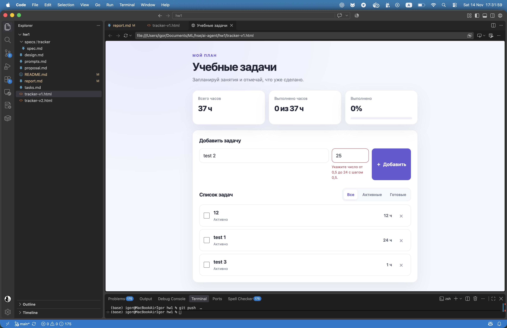
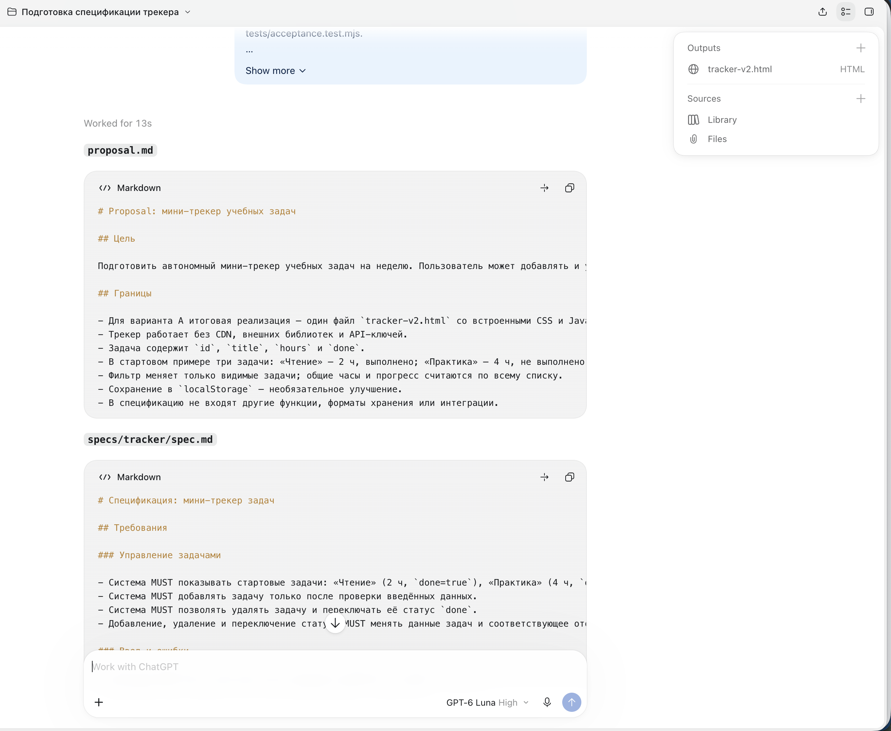
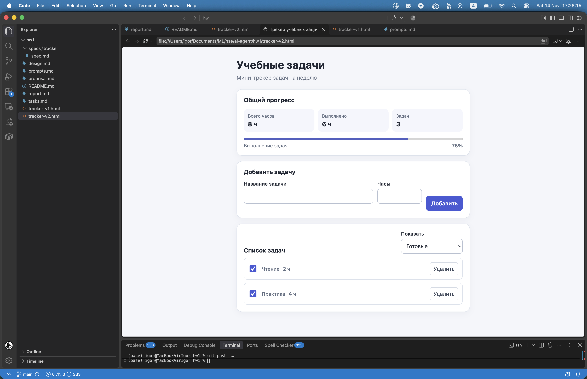

# Отчёт о задании 1. Вариант А

## Используемые модели

Для выполнения задания использлвался чат с моделью GPT-6 Luna High.

## Одно сообщение

Для выполнения 1 задания использовалось одно сообщение (полный текст в [prompts.md](prompts.md)). 
Модель справилась с первого раза выдать работоспособный код.
Проверка по заданиям:

### T1
3 задачи, всего 8 часов, выполнено 25%. Прогресса, сколько выполнено в часах, в интерфейсе нет, но длительность выполнения указана у каждой задачи отдельно.

### T2
Стало выполнено 75%, всё поменялось.
Прогресса в часах нет как и в T1.

### T3
Фильтр работает корректно.

### T4
Корректно работают: нижняя граница на длительность задач (положительность, хотя бы 0.25), шаг длительности задачи в 0.25, пустое название задачи.
Добавления задачи с названием только из пробелов некорректно: задача не добавляется, но и явной ошибки не высвечивается.
Ограничение на длительность задачи не больше 24 часов не соблюдено.

### T5
Удаление всех задач работает корректно.

После я попросил модель исправить ошибки.

Модель выдала новый код, указанные недочёты были исправлены.



## Предварительное планирование
Для выполнения 2 задания использовалось два сообщения (полный текст в [prompts.md](prompts.md)). 

После первого сообщения модель вывела в чат содерживое 4 файлов: [proposal.md](proposal.md), [specs.md](specs/tracker/spec.md), [design.md](design.md) и [tasks.md](tasks.md)



Вторым сообщением модель попросили реализовать трекер.
Помимо кода модель также указала, какие проверки были сделаны:
```txt
Проверено: JavaScript проходит проверку синтаксиса; в файле встроены CSS и JavaScript, внешних ресурсов и сетевых вызовов нет.

Проверьте в браузере: фильтр и сохранение общих итогов, добавление и удаление задач, переключение статуса, ошибки и сохранение значений формы, нулевые итоги после удаления всех задач, а также отображение на ширине 390 px. Браузерную проверку я не запускал.
```

Далее я провёл свои проверки.
### T1
3 задачи, всего 8 часов, выполнено 25%.
Указан прогресс выполнения в часах: 2/8.

### T2
Стало выполнено 75%, всё поменялось.
Прогресс в часах стал 6/8.

### T3
Фильтр работает корректно.

### T4
Корректно работают: границы на длительность задач (положительность, хотя бы 0.25, не больше 24), шаг длительности задачи в 0.25, пустое название задачи, добавление задачи с названием только из пробелов

### T5
Удаление всех задач работает корректно.



Дополнительных запросов к модели не делал, так как она хорошо выполнила задачу.

## Вывод

Современные модели уже достаточно мощны, чтобы выполнять задачу с перого промпта, однако в таком случае они допсуают ошибки.
Чтобы избежать их, можно попросить модель сначала составить план выполения задачи.
В простом примере вроде нашего это помогло полностью избавиться от ошибкок в реализации T1-T5.